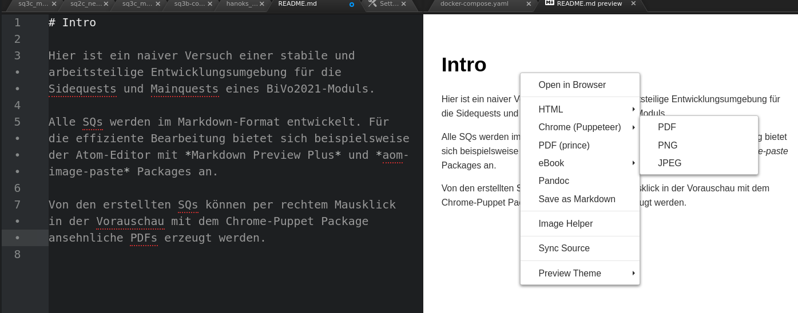

# Intro

Hier ist ein naiver Versuch einer stabile und arbeitsteilige Entwicklungsumgebung für die Sidequests und Mainquests eines BiVo2021-Moduls.

Alle SQs werden im Markdown-Format entwickelt. Für die effiziente Bearbeitung bietet sich beispielsweise der Atom-Editor mit *Markdown Preview Plus* und *atom-image-paste* Packages an.

# Neue SideQuests

... sollten auf der sq-template.md - Vorlage basieren

# PDF - Exports

Von den erstellten SQs können per rechtem Mausklick in der Vorauschau mit dem Chrome-Puppet Package ansehnliche PDFs erzeugt werden.

