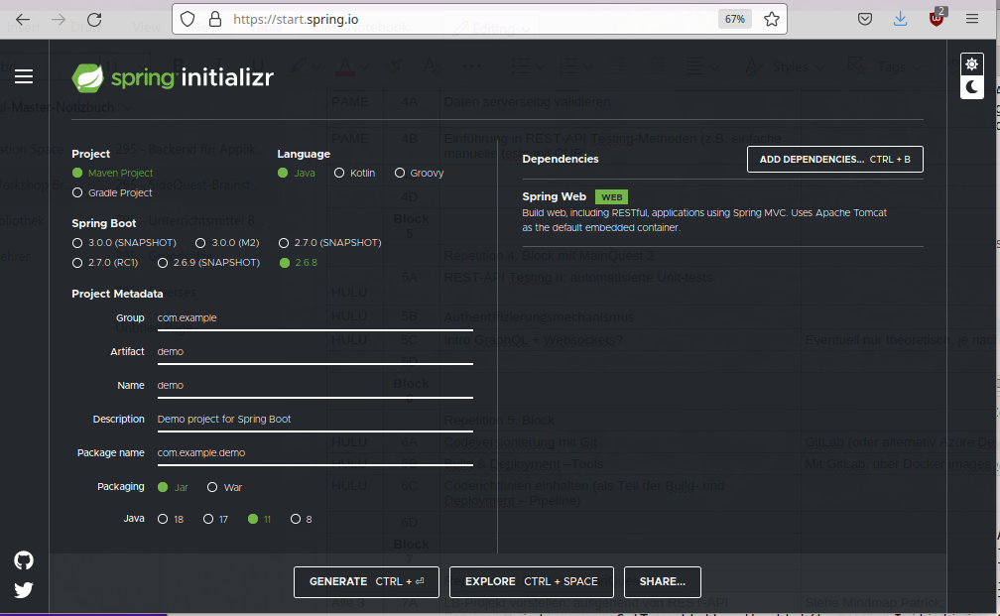
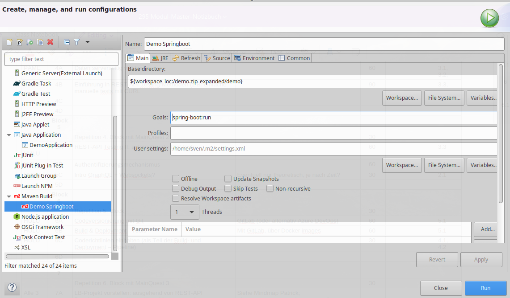

# Getting Started

* Eclipse J2EE installieren
* JDK 17

## Spring Boilderplate



**Frage:** Wie können wir die Aktualität und Wartbarkeit der Modulinhalte sicherstellen?

## DemoApplication.java

```
package com.example.demo;

import org.springframework.boot.SpringApplication;
import org.springframework.boot.autoconfigure.SpringBootApplication;
import org.springframework.web.bind.annotation.GetMapping;
import org.springframework.web.bind.annotation.RestController;

@RestController
@SpringBootApplication
public class DemoApplication {

	public static void main(String[] args) {
		SpringApplication.run(DemoApplication.class, args);
	}

	@GetMapping("/")
	public String index() {
		return "Greetings from Spring Boot!";
	}

}
```

## Run Configuration


