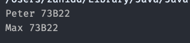

# SQ1C - Lambda & Generics

## Zeit - 45 Minuten

* 5 Minuten Einführung
* 30 Minuten Bearbeitung des Auftrags
* 10 Minuten Besprechung

## Lernart bzw. Sozialform

* praktische Einzelarbeit

## HANOKs

HANOK: 1.1, 1.3, 1.4, 2.2, 3.2

* Kennt den Unterschied zwischen imperativer und deklarativer/funktionaler Programmierung (deklaratives Programmierparadigma).
* Kennt Vor- und Nachteile funktionaler Programmierung.
* Kennt die Begriffe aus dem funktionalen Programmieren (z.B. Pure-Function, Immutable Data, Lambda-Expression, Function, Closure, Callback, Functor) und versteht diese, um sie korrekt anzuwenden.
* Kennt funktionale Programmierkonzepte (z.B. Filter-Map-Reduce) und passende Entwurfsmuster (z.B. Builder-Pattern).
* Kennt die funktionalen Elemente einer Programmiersprache und kann so Applikationen mit imperativen und deklarativen Programmierparadigma entwickeln.

Lernziele:

* Funktionale Interface "Consumer" in verschiedenen Formen anwenden.

## Einführung LP in das Basiswissen

### Consumer / Lambda

In Java gibt es eine Reihe von Funktionalen Interfaces, welche die Zusammenarbeit mit der StreamingAPI ermöglichen. In diesem Sidequest befassen wir uns mit dem Consumer, um ein Verständnis für Funktionale Interfaces zu bekommen.

Der Consumer ist ein Funktionales Interface und kann für Lambda Ausdrücke benutzt werden.

```java
Consumer printData = new Consumer<Student()>{
    @Override
    public void accept(Student s){
        System.out.println(s.getName() + " " + s.getClassName());
    }
}

studentList.forEach(printData);
```

Der Consumer erlaubt die Typisierung mit Hilfe von Generics. Es muss allerdings für jeden neuen generischen Consumer eine Methode implementiert werden: accept().

Diese Methode führt eine Operation auf dem übergebenen Argument - Doch was ist das übergebene Argument?

Mit Hilfe der Streaming API (aus dem nächsten SideQuest) kann man in Java funktionale Programierparadigmen und Funktionalitäten nutzen.

Die einfachste ist die .forEach Methode, welche einen Consumer als Argument entgegennimmt und diesem Consumer alle Elemente der Liste einzeln übergibt.

Beim Beispiel oben werden so z.B. von allen Studenten in der Liste studentList der Namen und Klassennamen auf der Konsole ausgegeben:



Alternativ kann man diesen Consumer auch abgekürtzt als Lambda Ausdruck definieren:

```java
Consumer<Student> printDataLambda = (s) -> System.out.println(s.getName() + " " + s.getClassName());
studentList.forEach(printDataLambda);
```

Bei einem Lambda Ausdruck wird zuerst in Klammern ein Argumentname definiert (oft einzelne Buchstaben, es sind aber beliebig lange Namen möglich). Dieses Argument hat den Typ den man mit Hilfe des Generic Interfaces definiert.

Nach den Klammern folgt ein -> gefolgt von einem Befehl. Für mehrere Befehle werden nicht direkt die Befehle mitgegeben, sondern zuerst noch ein Block mit Hilfe von {} erstellt:

```java
Consumer<Student> printDataLambda = (s) -> {
    System.out.println("Studentendaten:");
    System.out.println(s.getName() + " " + s.getClassName());
}
```

Auch dieses Objekt kann direkt der forEach Methode (und weiteren StreamAPI Methoden) übergeben werden.

Allerdings kann es schnell unübersichtlich und cluttered werden, wenn unser Code voller solcher Objekte und deren Definitionen ist. Weiterhin gibt es auch "Vordefinierte" Consumer Arten bei bestimmten Funktionen wie "reduce". Dort werden z.B. mehrere Argumente gefragt.

Viele dieser Streaming API Methoden nutzen auch overloads dieser Consumer, oft ändert sich dort lediglich die Anzahl der Argumente.

Um diese effizient nutzen zu können, wird oftmals der Lambda-Ausdruck statt in einem Consumer, direkt diesen Methoden übergeben. Der Syntax bleibt dabei unverändert:

```java
studentList.forEach((student) -> {
    System.out.println("Studentendaten:");
    System.out.println(s.getName() + " " + s.getClassName());
});
```

### Generics

Generics ermöglichen das Erstellen und Nutzen von Klassen/Typen, die nicht an einen bestimmten Typ gebunden sind.

Ein klassisches Beispiel dafür sind Listen wie ArrayLists: Java ermöglicht Listen für jeden Objekt-Datentyp, es gibt aber nicht extra eine Klasse IntegerArrayList, StringArrayList, etc… sondern hier wird mit Generics gearbeitet.

Beim Programmieren kann man den Typ, der in der Liste gehalten wird mit der Diamond-Notation mitgeben:

```java
ArrayList<Integer> intList = new ArrayList<>(); 
```

So teilt man der Liste mit, dass nur Integer Typen gehalten werden können/sollen.

Will man selbst eine Generische Klasse erstellen, kann man dies ebenfalls mit der Diamond Notation machen:

```java
class Test<T> { 
    // An object of type T is declared 
    T obj; 
    Test(T obj) { this.obj = obj; } // constructor 
    public T getObject() { return this.obj; } 
} 
```

Hier steht `<T>` stellvertrettend für irgend einen Typen, den man beim Programmieren mitgeben muss, z.B.: `Test<Integer> iObj = new Test<Integer>(15);`

In diesem Beispiel wird das attribut "T obj" zur Laufzeit direkt als Integer interpretiert und der Wert 15 rein gespeichert.

Beim Beispiel:  

```java
Test<String> sObj = new Test<String>("WISS"); 
```

Wird hingegen **T** zu **String**, dh. "T obj" ist zur Laufzeit ein String mit dem Wert "**WISS**".

### Unboxing

In Java gibt es primitive Datentypen und Objekte.  

Primitive Datentypen sind z.B.:

* int
* char

Objekte sind z.B.:

* List
* String

Es gibt aber auch Objekttypen die auf primitiven Datentypen aufbauen, wie z.B.:

* Integer

Dabei gibt es verschiedene Regeln wie die Konvertierung/Handhabung von int zu Integer stattfinden.

Autoboxing convertiert primitive Datentypen automatisch in das entsprechende Objekt. z.B.: `Integer inum = 3; //Assigning int to Integer: Autoboxing`

Dies ermöglicht z.B. das Arbeiten mit Listen aus ints:

```java
ArrayList<Integer> arrayList = new ArrayList<Integer>();

//Autoboxing: int primitive to Integer
arrayList.add(11);
arrayList.add(22);
```

Unboxing konvertiert die Objektwrapper wie z.B. Integer zurück zu ints.

i.d.R. passiert dies automatisch. Z.B:

```java
Integer intObject = new Integer(5);

int num = intObject; //unboxing object to primitive type
```

Z.T. muss aber auch explizit gecasted werden:

```java
ArrayList<Integer> arrayList = new ArrayList<Integer>();

arrayList.add(10);

int num = (int) arrayList.get(0);
```

### Weitere Literatur zum Thema

* Prähofer Buch Kapitel 2.1, 2.3, 2.4
* Java Doc: <https://docs.oracle.com/javase/8/docs/api/java/util/function/Consumer.html>
* Ausführliche (evtl. zu sehr) Erklärung: <https://medium.com/swlh/understanding-java-8s-consumer-supplier-predicate-and-function-c1889b9423d>
* Consumer Beispiele: <https://www.geeksforgeeks.org/java-8-consumer-interface-in-java-with-examples/>

## Ausgangslage

Die Lerndenen wissen, was ein Consumer und ein Lamdba sind. Die entsprechenden IDEs etc, sollten in den vorherigen SideQuests bereits installiert worden sein.

Für eine Bibliothek sollen alle Bücher auf der Konsole ausgegeben werden.

## Ziele / erwartete Lernergebnisse

Es werden alle Bücher im gewünschten Format ausgegeben. Die Lernenden kennen verschiedene Methoden den Consumer einzusetzen.

## Auftrag

1. Neues Projekt "Bibliothek" erstellen
1. Neue Klasse Buch mit den folgenden Attributen:
    * Author
    * Titel
    * Seitenzahl
1. Es soll eine Liste mit 5 verschiedenen Büchern erstellt werden (im Main)
1. Diese Liste soll dreimal ausgegeben werden:
    * Nur Titel der Bücher mit Hilfe des Consumer Interfaces
    * Titel und Author der Bücher mit Hilfe des Consumer-Lambda Objektes
    * Titel, Author und Seitenzahl mit Hilfe eines Lamdba Ausdruckes

Für diese Aufgabe soll die `forEach()`-Methode der Liste gebraucht werden.

## Evaluation Lernende

Gruppen präsentieren sich gegenseitig ihre Ergebnisse.

## Benötigte Software

* IDE (IntelliJ, Eclipse, VSCode, od.ä.)
