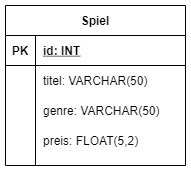

# SQ3A - JDBC

## Zeit - 75 Minuten

* 10 Minuten Einführung
* 50 Minuten Bearbeitung der Aufgabe
* 15 Minuten Besprechung

## Lernart bzw. Sozialform

* Einzelarbeit

## HANOKs & Lernziele

HANOKs: -

Lernziele:

* Du kennst den Nutzen der JDBC Bibliothek
* Du kannst JDBC nutzen um auf eine Datenbank zu zugreifen
  * Verbindungsaufbau
  * Statement absetzen
  * Daten verarbeiten

## Einführung LP in das Basiswissen

* Was ist JDBC?
* Wie verwendet man JDBC?

## Literatur zum Thema

* Praehofer "Funktionale Programmierung" Kapitel 4.1, 7
* [Java Database Connectivity with 5 Steps](https://www.javatpoint.com/steps-to-connect-to-the-database-in-java)
* [PreparedStatement interface](https://www.javatpoint.com/PreparedStatement-interface)
* [ResultSet interface](https://www.javatpoint.com/ResultSet-interface)

## Ausgangslage

Du bringst bereits Erfahrungen im Umgang mit Datenbanken und grundlegende JAVA-Kenntnisse mit. Dies wollen wir uns nun zu Nutze machen um Datensätze aus in einer Applikation permanent abzuspeichern und weiter zu verarbeiten.

Die EDUGames AG möchte die grundlegenden Information von Spielen mittels einer Applikation in einer Datenbank ablegen und daraus auch auslesen können. Hierfür legen wir eine kleine Datenbank samt einer Tabelle **Game** an und greifen darauf aus einer _Konsolenapplikation_ zu.  

ERD der Datenbank **m232_sq3a**:  

## Ziel

* Du sollst wissen mit welchen Mitteln du aus einem JAVA Programm auf eine Datenbank zugreifen kannst
* Du kannst Datensätze aus einer Datenbank herauslesen und in JAVA-Objekte umwandeln
* Du kannst JAVA-Objekte permanent in einer Datenbank ablegen

## Auftrag

1. Erstelle eine Datenbank **m323_sq3a** und teste ob die Verbindung darauf klappt
1. Importiere das Projekt **sidequest3a** des Unterrichtsmittels in deine IDE, das grundlegende Setup ist bereits gemacht
    * In der Klasse **Programm** läuft das Programm, hier fügst du generellen Code ein
    * In der Klasse **DBHelper** sind bereits Methodenrümpfe vorbereitet, hier fügst du datenbankspezifischen Code hinzu (Kommentare beachten)
1. Konfiguriere das Projekt so, dass du damit einen Verbindugnstest mit der Datenbank durchführen kannst
    * Frage die Lehrperson, falls es Probleme gibt
1. Erstelle in der Datenbank eine Tabelle **spiel** mit den in der Ausgangslage beschriebenen Spalten
1. Implementiere im Projekt eine Modell-Klasse **Spiel** mit den Feldern, welche in der Datenbank vorkommen
1. Implementiere im **Programm** den Code um alle Spiele aus der Datenbank auszulesen und gib diese in der Konsole aus
1. Implementiere im **Programm** den Code um der Datenbank 3 weitere Spiele hinzuzufügen
1. Teste ob die Spiele in der Datenbank angekommen sind entweder mit der Ausgabe in der Konsole (Read der Datenbank) oder im entsprechenden DB-Verwaltungstool

## Wissens-Check

* Welche Abfolge Durchläuft der Prozess um Daten zu laden bei der Verwendung von JDBC? <!-- Verbindungsaufbau, Query Erzeugen, Query Absetzen, ResultSet auslesen -->
* Weshalb sollten Datenbankverbindung nach beendigter Arbeit stets geschlossen werden? <!-- Es können nur eine bestimmte Anzahl vor Verbindungen gleichzeitig offen sein. Ist dieses Limit erreicht können keine neuen Verbindungen geöffnet werden und Anfragen werden fehlschlagen. -->
