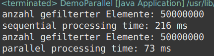

# SQ4a - Parallele Verarbeitungsmöglichkeiten

## Zeit

* 45 Minuten

## Lernart bzw. Sozialform

* Partnerarbeit

## HANOKs

1.2	Kennt Vorgehensweisen zur deklarativen Beschreibung von Problemen und Endzuständen. 

1.3	Kennt Vor- und Nachteile funktionaler Programmierung. 

1.4	Kennt die Begriffe aus dem funktionalen Programmieren (z.B. Pure-Function, Immutable Data, Lambda-Expression, Function, Closure, Callback, Functor) und versteht diese, um sie korrekt anzuwenden. 

2.2	Kennt funktionale Programmierkonzepte (z.B. Filter-Map-Reduce) und passende Entwurfsmuster (z.B. Builder-Pattern). 

2.3	Kennt Wege um funktionalen Code verteilt, parallel und nebenläufig auszuführen. 

3.2	Kennt die funktionalen Elemente einer Programmiersprache und kann so Applikationen mit imperativen und deklarativen Programmierparadigma entwickeln. 


## Einführung LP in das Basiswissen

* Intro: Gedankenspiele
  - Welche Tätigkeiten kannst Du alleine parallelisieren (gleichzeitig machen)?
    - Gamen
    - Lesen
    - Fahrrad fahren
    - Joggen
    - Plaudern
    - Kochen
  - Welche Tätigkeiten lassen sich im Team ausführen (und worauf musst du dabei achten)?
    - Kirschen ernten
    - Post austragen
    - Kuchen backen

* Fallbeispiel:
  - gegeben: Liste von gegnerischen Raumschiffen in 2D-Game
  - gesucht: Liste von gegnerischen Raumschiffen, die nicht abgeschossen wurden (z.B. energy>0)
  - Naiver Ansatz: Liste von gegnerischen Raumschiffen durchlaufen und alle Raumschiffe mit energy <= 0 entfernen) --> Seiteneffekt, der Array selbst wird verändert.
  - Besser: alle Raumschiffe mit energy > 0 in neuen Array kopieren, und zum Schluss alten durch neuen Array ersetzen
* sequentielle vs. parallele Bearbeitung: teile und herrsche -> lange Listen aufsplitten und mit mehreren Threads die Teil-Listen parallel durchsuchen
* Speed-up, Stolpersteine (geht nur mit Pure Functions)


### Weitere Literatur zum Thema

* Praehofer, Funprog, Kap. 8.1
* [Javadoc IntStream](https://docs.oracle.com/en/java/javase/17/docs/api/java.base/java/util/stream/IntStream.html)
* [Javadoc Calendar](https://docs.oracle.com/en/java/javase/17/docs/api/java.base/java/util/Calendar.html)

## Ausgangslage

Lange Datenstrukturen lassen sich unter Umständen deutlich schneller bearbeiten, wenn man sie in Häppchen aufteilt und parallel verarbeitet.

## Ziel

Du kannst Datenstrukturen parallel verarbeiten und den Zeitgewinn gegenüber der sequentiellen Verarbeitung messen.

## Auftrag

Erstelle eine neue Java-Klasse `Block4_Parallel` mit einer `public static void main` - methode. Darin programmierst du die folgenden Anweisungen:

1. Erstelle einen Array *zahlen* mit den Zahlen von 0 bis 10^9 (siehe Javadoc für die Klasse *IntStream*)
2. Erstelle eine Variable t0 mit dem aktuellen Zeitstempel (z.B. als Instanz der *Calendar*-Klasse)
3. Streame den *zahlen*-Array, filtere die geraden Zahlen und zähle die Anzahl in einer Anweisung (Hinweis: nutze `IntStream.of(zahlen)` zum streamen).
2. Erstelle eine Variable *t1* mit dem aktuellen Zeitstempel (z.B. als Instanz der *Calendar*-Klasse). Die `getTimeMillis()`-Funktion der *Calendar*-Klasse gibt die Millisekunden zurück. Damit kannst Du die Zeitdifferenz von *t0* und *t1* berechnen und auf der Konsole ausgeben.
2. Setze t0 auf den aktuellen Zeitstempel.
2. Streame den *zahlen*-Array wie oben, dann **parallelisiere** diesen Stream. Darin filterst du die geraden Zahlen und zählst die Anzahl in einer Anweisung.
2. Setze *t1* auf den aktuellen Zeitstempel und berechne die Zeitdifferenz von *t0* und *t1* für die parallele Bearbeitung. Was stellst Du fest?


## Wissens-Check

1. Welchen Vorteil hat die parallele Bearbeitung von Aufgaben? <!-- schneller -->
1. Was muss man bei der parallelen Bearbeitung von Aufgaben beachten? <!-- parallele prozesse dürfen sich nicht in die Quere kommen und sollten möglichst wenig voneinander abhängig sein (reine Funktionen verändern die Ausgangsdaten nicht) -->
1. Nenne Beispiele für einfach parallelisierbare Prozesse. <!-- Kirschen pflücken, Unkraut jäten -->
1. Nenne Beispiele für schwieriger parallelisierbare Prozesse. <!-- Software-Entwicklung, Kochen -->

## Lösung:

<!--
```java
int[] data = IntStream.range(0, 100000000).toArray();
Calendar cal0 = Calendar.getInstance();
long elems = IntStream.of(data).filter(x -> x%2 == 0).count();
long tDelta = Calendar.getInstance().getTimeInMillis() - cal0.getTimeInMillis();

System.out.println("anzahl gefilterter Elemente: "+ elems);
System.out.println("sequential processing time: "+tDelta+" ms");

cal0 = Calendar.getInstance();
elems = IntStream.of(data).parallel().filter(x -> x%2 == 0).count();
tDelta = Calendar.getInstance().getTimeInMillis() - cal0.getTimeInMillis();

System.out.println("anzahl gefilterter Elemente: "+ elems);
System.out.println("parallel processing time: "+tDelta+" ms");
```
-->


